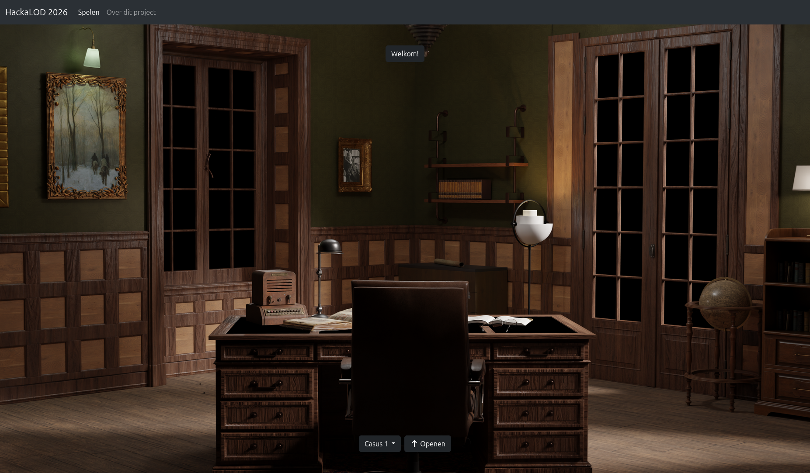
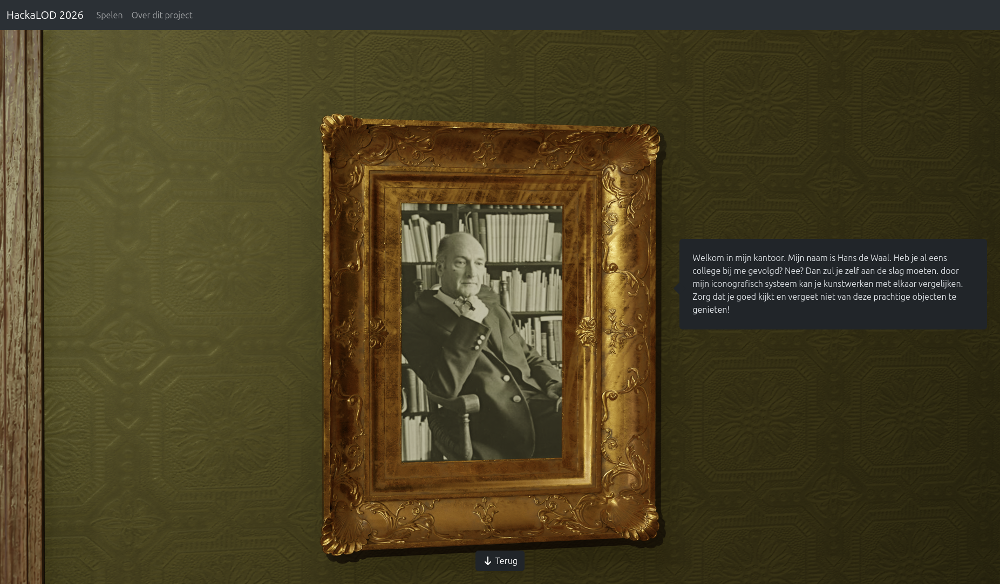
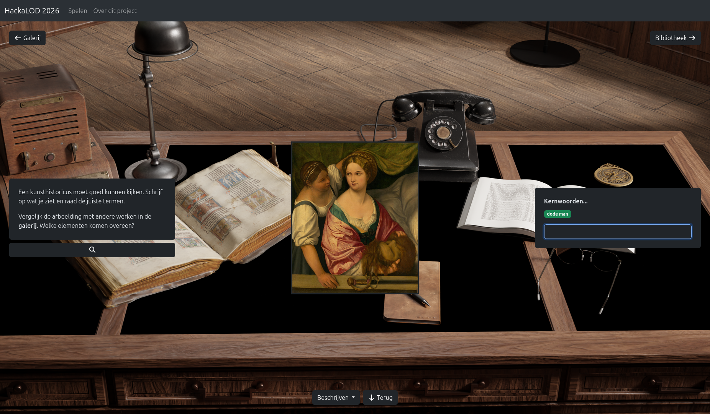
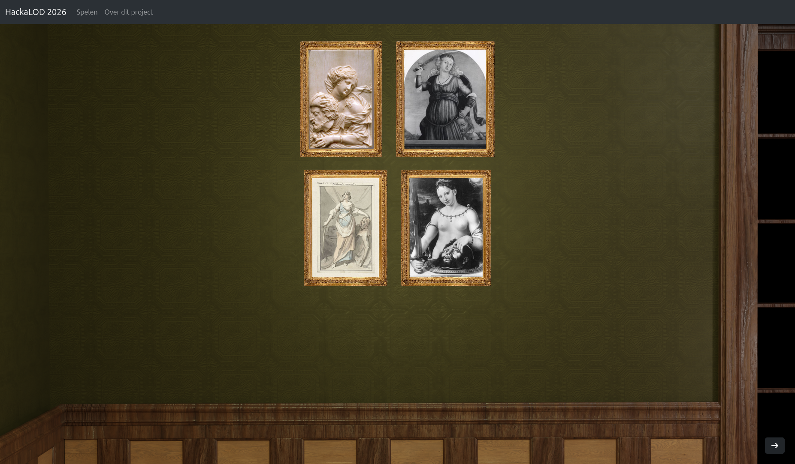
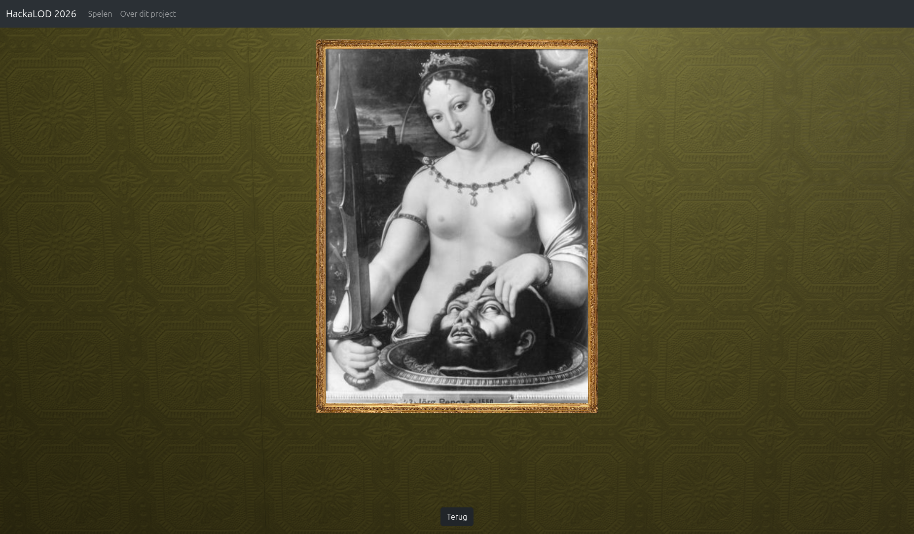
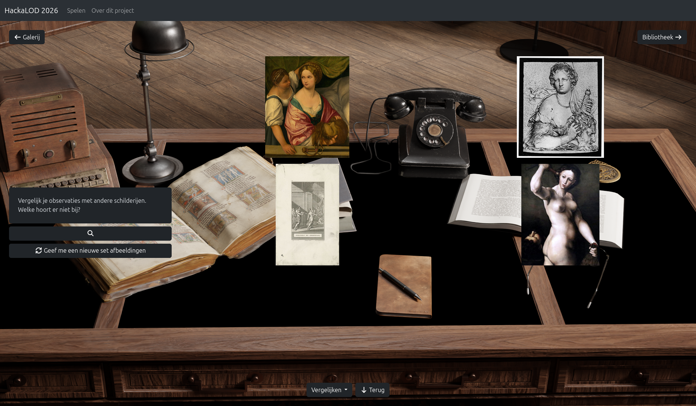
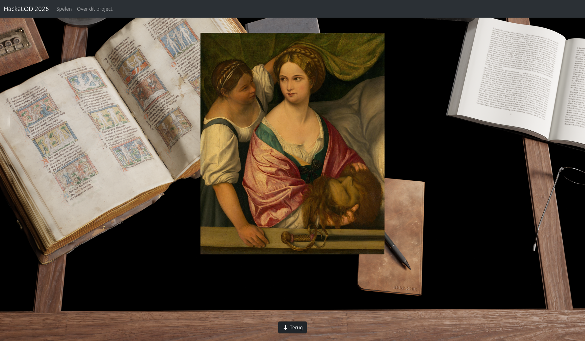
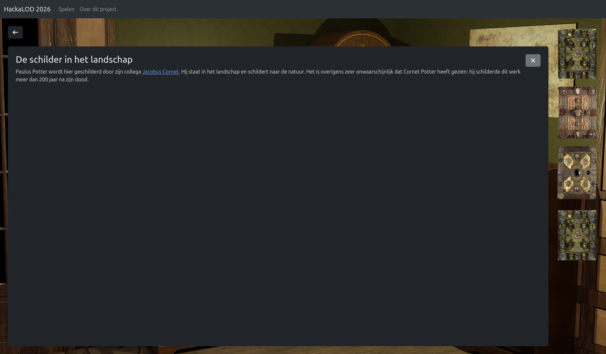

# HackaLOD 2026: DECODE/Art_detective

On October 30th-31st 2026, the Centre for Digital Humanities participated in [HackaLOD](https://netwerkdigitaalerfgoed.nl/hackalod/). Alongside 10 other teams, we had 24 hours to develop an an application that would combine Linked Open Data from multiple cultural heritage institutions and show the value of linked cultural heritage data to a general public.

For this challenge, we created **DECODE/Art_detective**, a game where players can step into the workspace of an art historian and learn to decode and connect works of art.

Art historians have been trying to categorise art for centuries. By labelling something, you can compare and identify it. In the 1950s, Dutch art historian Hans de Waal tried to develop a systematic method to code and index the subjects, themes and motifs in Western visual art. This code, [iconclass](https://iconclass.org/), is a hierarchical system that categorises artworks based on their visual content. The game uses this system to let players analyse and compare works based on their content.

The game consists of a set of hand-picked case studies, each centred around a single art work. Per case study, players are first tasked to describe what they see. This minigame is completed by entering keywords for visual elements of the work. To help them out, players can look at a gallery of similar works, and consult a "library" with hints and background information.

In the second minigame, players are given four works to compare, and asked to select the odd one out. Here, players can make use of the visual elements they identified in the previous game.

To show comparable works, the game draws from the collections of the [RKD](https://www.rkd.nl/) and [Rijksmuseum](https://www.rijksmuseum.nl/). It uses the iconclass categorisations in these collections to identify similar works. In this way, the game can link works that would never be hung in the same room in the physical world, and encourage players to draw new connections in our cultural heritage.

## Creators

This project was a collaboration between the ArtLab at the Research Software Lab at the Centre for Digital Humanities, Utrecht University. Our team consisted of (in alphabetical order):

- Tijmen Baarda
- Cuno Balfoort
- Jelte van Boheemen
- Sanne Frequin
- Sjors Nab
- Luka van der Plas

## Screenshots

## Contents

This repository contains the code we created during the HackaLOD event. This builds on the [cookiecutter web application](https://github.com/CentreForDigitalHumanities/cookiecutter-webapp-deluxe) maintained by the Research Software Lab. It consists of a Django backend and Angular frontend.

Background images for the interface were created in Blender during the Hackathon event.

Due to the nature of the challenge, this code is *not* production ready.

## Licence

This work is shared under a BSD 3-Clause licence. See [LICENSE](./LICENSE) for more information.

## Citation

To cite this repository, please use the metadata provided in [CITATION.cff](./CITATION.cff).

## Contact

This project is developed by the [ArtLab, Centre for Digital Humanities, Utrecht University](https://cdh.uu.nl/about/artlab/) and [Research Software Lab, Centre for Digital Humanities, Utrecht University](https://cdh.uu.nl/about/research-software-lab/). Please contact the [Centre for Digital Humanities](https://cdh.uu.nl/about/contact/) if you have questions.
